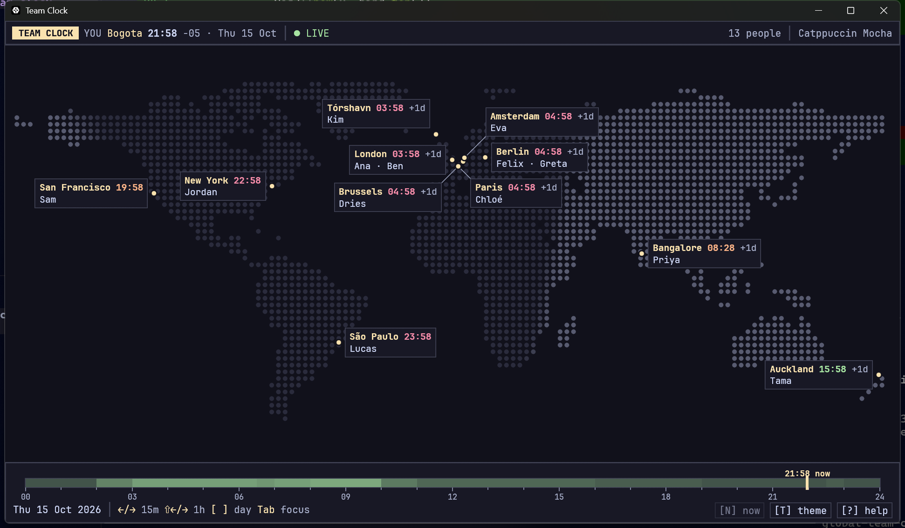

# team-clock

A small desktop app that puts everyone in a distributed team on a dot-matrix world map,
labelled with their name, city and local time. Drag through the day with the time slider
(or the keyboard) to see when everyone is awake, in the office, or asleep. It looks like a
terminal, ships with popular colour schemes, works entirely from the keyboard, and reads
your team from one hand-edited `team.toml`. It runs on Windows, macOS and Linux as a single
self-contained binary.



## Features

- Dot-matrix world map with a day/night terminator
- Name, city and live local time for every teammate; people in the same city are grouped
- Time slider for scrubbing forward and back through hours and days (DST-correct via the embedded tz database)
- Built-in database of about 6,000 cities (GeoNames), so you usually only need to type a city name
- Manual `lat`/`lon`/`tz` override for anywhere the database doesn't cover
- 13 colour schemes; your choice is saved back to `team.toml`
- Fully keyboard-driven, with a `?` help overlay
- All assets (map, cities, font) are embedded: one executable plus your `team.toml`

## Quick start

```sh
cargo run --release -- examples/team.toml
```

### Where `team.toml` is found

1. The path given on the command line: `team-clock path/to/team.toml`
2. `./team.toml` in the current directory
3. The platform config directory (via the [`directories`](https://crates.io/crates/directories) crate):

| OS      | Path                                                  |
|---------|-------------------------------------------------------|
| Windows | `%APPDATA%\team-clock\config\team.toml`               |
| macOS   | `~/Library/Application Support/team-clock/team.toml`  |
| Linux   | `~/.config/team-clock/team.toml`                      |

## Config format

```toml
theme = "catppuccin-mocha"   # optional; T / Shift+T in the app updates this

[[person]]
name = "Ana"
city = "Lisbon"              # looked up case-insensitively

[[person]]
name = "Sam"
city = "Portland, OR"        # ", qualifier" = country or state, code or name

[[person]]
name = "Kim"
city = "Tórshavn"            # with lat/lon/tz the city is just a label
lat = 62.01
lon = -6.77
tz = "Atlantic/Faroe"        # IANA timezone name
```

City names match the official name, its ASCII spelling or a known alternative
(`Bangalore` finds Bengaluru; `Sao Paulo` and `São Paulo` both work). When a name is
ambiguous (there's a London in Canada too), add a qualifier to pick the one you mean.
See [`examples/team.toml`](examples/team.toml) for a complete example.

## Keyboard shortcuts

| Key                     | Action                                      |
|-------------------------|---------------------------------------------|
| `←` / `→`               | Move time −/+ 15 minutes                    |
| `Shift+←` / `Shift+→`   | Move time −/+ 1 hour                        |
| `[` / `]`               | Move time −/+ 1 day                         |
| `Home` / `End`          | Start / end of the day                      |
| `N`                     | Back to now                                 |
| `T` / `Shift+T`         | Next / previous theme (saved to `team.toml`)|
| `Tab` / `Shift+Tab`     | Focus next / previous city group            |
| `?`                     | Help overlay                                |
| `P`                     | Edit people: add / edit / delete (saved to `team.toml`) |
| `R`                     | Reload `team.toml`                          |
| `Q` / `Esc`             | Quit, or close the overlay                  |
| `Ctrl+Q` / `⌘+Q`        | Quit                                        |

## Themes

Catppuccin Mocha (default), Catppuccin Macchiato, Catppuccin Frappé, Catppuccin Latte,
Gruvbox Dark, Gruvbox Light, Nord, Dracula, Tokyo Night, Solarized Dark, Solarized Light,
One Dark.

## Building

Install a stable Rust toolchain from [rustup.rs](https://rustup.rs), then:

```sh
cargo build --release      # binary in target/release/team-clock(.exe)
cargo test
```

Platform requirements:

- **Windows:** Visual Studio Build Tools with the "Desktop development with C++" (MSVC) workload.
- **macOS:** Xcode Command Line Tools (`xcode-select --install`).
- **Linux (Debian/Ubuntu):**
  ```sh
  sudo apt-get install libxkbcommon-dev libwayland-dev libxcb-render0-dev \
    libxcb-shape0-dev libxcb-xfixes0-dev libgl1-mesa-dev
  ```
- **Linux (Fedora):**
  ```sh
  sudo dnf install libxkbcommon-devel wayland-devel libxcb-devel mesa-libGL-devel
  ```

## Regenerating the assets

`assets/landmask.bin` and `assets/cities.csv` are generated by the helper crate in
`tools/gen-assets` from:

- [Natural Earth](https://www.naturalearthdata.com/) 1:50m land polygons as GeoJSON (`ne_50m_land.geojson`)
- [GeoNames](https://download.geonames.org/export/dump/) `cities15000.txt`, `countryInfo.txt` and `admin1CodesASCII.txt`

```sh
cd tools/gen-assets
cargo run --release -- landmask ne_50m_land.geojson ../../assets/landmask.bin
cargo run --release -- cities cities15000.txt countryInfo.txt admin1CodesASCII.txt ../../assets/cities.csv
```

## Attributions

- City data: [GeoNames](https://www.geonames.org/), licensed under [CC BY 4.0](https://creativecommons.org/licenses/by/4.0/).
- Land outlines: [Natural Earth](https://www.naturalearthdata.com/), public domain.
- Font: [JetBrains Mono](https://www.jetbrains.com/lp/mono/), SIL Open Font License 1.1 (see `assets/fonts/OFL.txt`).

## License

MIT. See [LICENSE](LICENSE).
